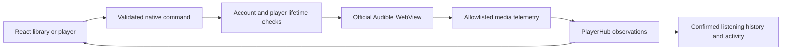

# Developer walkthrough

Start with this guide for the behavior and boundaries, [the source index](SOURCE_INDEX.md)
to locate a module, and [contributing](../CONTRIBUTING.md) for formatting and tests.
Each source module has a summary; public contracts and complicated transitions have
additional comments near the code. These explain intent, not a promise that every
service integration has been verified against a live account.

## Which playback path is supported?

The Windows release uses the **official Audible website player** inside a separate
hosted window. Our React windows provide the library, controls, saved moments and
reviews. The native host validates and translates commands; injected scripts operate
on the official page's media/UI. React does not receive account tokens or audio keys.

The direct-streaming, ordinary-browser comparison and upload experiments remain in
the source for investigation. They are not equivalent to the shipped playback path.
A successful metadata request, a streaming grant and a supported DRM runtime are
different checks; none alone proves a playable license will be issued. See the
`cfg(debug_assertions)` registrations and release packaging assertions before changing
what the release exposes.

## Follow an ordinary action

1. `main.tsx` chooses the main, mini or artwork surface. `App.tsx` owns main-screen
   navigation and account/library orchestration. Sections remain mounted but hidden
   so drafts survive navigation; the persistent player stays outside those sections.
2. `OfficialAdapter` sends an action through Tauri. Main and mini controls use the
   same `MiniPlayer` component; embedded mode changes window management, not audio.
3. Native command handlers verify the caller's local origin and appropriate window.
   `main.rs`, `launch.rs` and `desktop.rs` manage the official window and selected title.
   The injected launcher selects that book's real **Listen now** action.
4. `bridge.js` reports bounded media state and accepts the host's player commands.
   Remote pages do not receive general Tauri IPC privileges. A visible sample must
   not be mistaken for full owned-title playback.
5. Live observations update UI state. `history.rs` and `activity.rs` separately decide
   which observations count as confirmed listening or deliberate position choices.
   Merely loading a player or refreshing metadata must not overwrite a good checkpoint.

## Three different kinds of identity

- **Account generation:** a native lifetime token. A sign-out/reconnect invalidates
  pending work. A queued save must use the generation it captured, not whichever
  account happens to be connected when its request finishes.
- **UI request revision:** makes a superseded response harmless within one window.
  It is not a credential and does not replace native account authorization.
- **Player/launch revision:** prevents a late callback, seek or sync response from
  controlling a different title or a replaced official window.

Capture the relevant identity before starting async work and check it again before
publishing or persisting a result. Never hold native account/player locks while
waiting for network I/O or synchronous WebView creation/getters: the UI thread may
need those same locks to deliver telemetry. See `player_sync.rs` for the confirmed
seek pattern and `metadata::with_account_db` for account-pinned persistence.

## Persistence and privacy

Account tokens and database keys use Windows protection; library/history, saved
moments, preferences and reviews live in encrypted local stores. Development and
installed builds use separate scopes. The official website has its own local browser
profile/session and can require verification independently of the library API.

Book-specific library/history, saved moments and reviews are separated by account.
Appearance and listening preferences use the shared encrypted settings store within
the build scope; the immediate theme cache is non-secret. Do not describe those
shared preferences as account-specific private content.

Signing out revokes active access and clears/hides the UI; retaining an encrypted
account database is different from remaining signed in. Missing keys must fail
without replacing a database or falling back to plaintext. DPAPI and file permissions
do not protect an account from malware already running as its Windows user or an
administrator. Read [privacy](PRIVACY.md) and [security](../SECURITY.md) before changing
these boundaries.

Diagnostics accept fixed categories and relative timings, not arbitrary exception
strings, URLs, account identifiers, books, reviews or note content. Readable notes
exports are a separate, explicit private-data operation. No diagnostic uploader is
enabled by this app.

## Saved moments, reviews and sync

- Bookmarks, clips and notes are metadata. Clips replay a range of the official
  player's real timeline; they are not recorded audio files. Replay can therefore
  change service progress, and returning to a listening point is an explicit seek.
- Annotation sync is experimental and explicit. `annotation_links` stores stable
  remote identity plus the baseline and remote preview for three-way reconciliation.
  `annotation_attempts` persists uncertain sends so retries do not blindly duplicate
  a cloud annotation. Missing/unknown responses must not become silent deletions.
- Ratings/reviews are local-only and do not use annotation sync. `rating` is integer
  tenths from 0 to 50; `null` is unrated, while 0 is a real score. An edit supplies its
  expected original value so stale drafts cannot replace newer content unnoticed.
- Audible's last-position read has no verified cloud listening timestamp here. Do
  not select the furthest position or use the read time as proof of the newest listen.
  Preserve conflicts and require an informed user choice.

## Configuration and generated files

| File                                                   | What to change here                                                      |
| ------------------------------------------------------ | ------------------------------------------------------------------------ |
| `package.json`                                         | Frontend dependencies and developer command entry points                 |
| `tsconfig.json`, `vite.config.ts`                      | Type checking, bundling and the local development port                   |
| `index.html`                                           | Main frontend entry; keep development comparison UI separate             |
| `browser-test.html`                                    | Development comparison entry; not the shipped app shell                  |
| `src-tauri/Cargo.toml`                                 | Native dependencies and feature flags                                    |
| `src-tauri/build.rs`                                   | Standard Tauri build-time resource generation                            |
| `src-tauri/tauri.conf.json`                            | Product/version, release windows, resource and installer policy          |
| `src-tauri/tauri.debug.conf.json`                      | Development-only window/devtools overrides                               |
| `src-tauri/capabilities/`                              | Window-specific Tauri permissions; do not broaden remote access casually |
| `.github/workflows/windows.yml`                        | Windows tests, audits, packaging and deliberate release asset handling   |
| `.editorconfig`, `.prettierrc.json`, `.prettierignore` | Authored-source formatting and generated/private-file exclusions         |

JSON files are documented here because adding comment fields can violate their
schemas. Lockfiles, generated license notices, dependencies, build output and local
experiments should not receive hand-written explanatory comments. Update the source
or its guide instead.

## Comment and size policy

Keep module summaries current when responsibilities change. Document parameter
units, lifetime assumptions, failure behavior and important side effects at public
boundaries; explain complicated branches beside the code. Tests should explain what
their synthetic fixtures prove and what still needs live/manual validation. Avoid
restating every assignment or adding boilerplate to obvious private helpers.

Ordinary TypeScript/CSS comments are normally stripped by the production bundler;
Rust documentation comments are not runtime documentation files. Injected JavaScript
is different: `include_str!` embeds its readable text, including comments, in the
native executable. Source/docs growth and compressed installer growth therefore
need separate measurements. Build both with the same version/configuration; exclude
`.git`, dependency/build caches, generated outputs and local private stores when
reporting authored repository size. Small installer differences can also reflect
compression/build metadata, so do not equate every changed byte with a comment byte.
